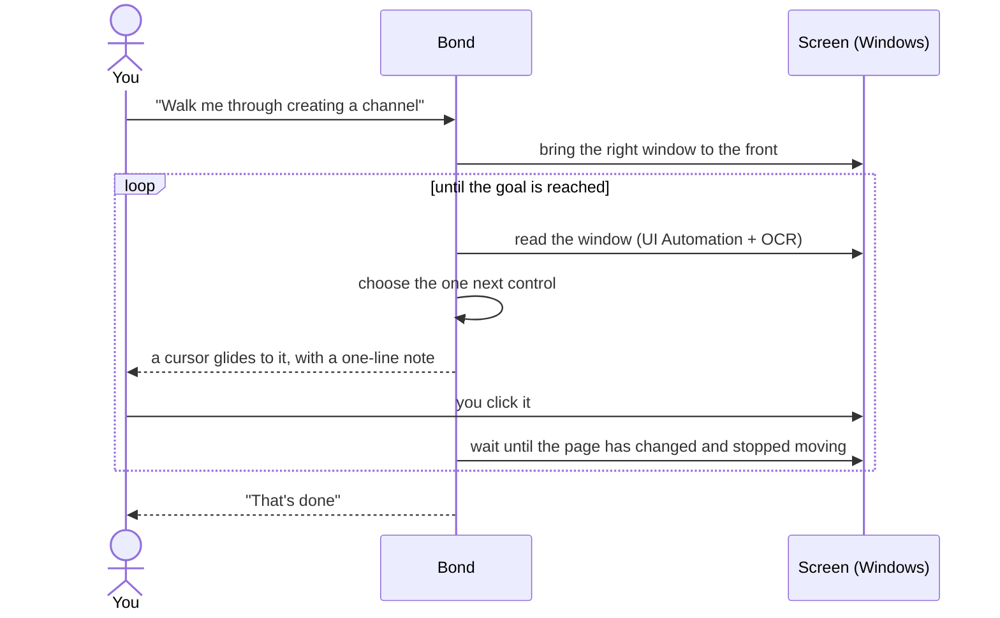
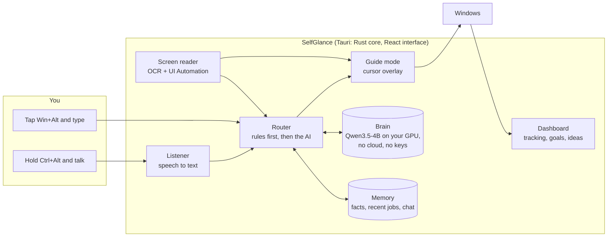

<h1 align="center">SelfGlance</h1>

<p align="center">
  <b>Bond is a desktop guide for Windows. He looks at your screen, shows you where to click next, and keeps all of it on your laptop.</b>
</p>

<p align="center">
  
  
  
  
  
  
</p>

<p align="center">
  <a href="#what-it-is">What it is</a> ·
  <a href="#guide-mode">Guide mode</a> ·
  <a href="#around-the-guide">Around the guide</a> ·
  <a href="#the-dashboard">Dashboard</a> ·
  <a href="#how-it-works">How it works</a> ·
  <a href="#privacy">Privacy</a> ·
  <a href="#run-it">Run it</a> ·
  <a href="#status">Status</a>
</p>

<p align="center">
  <picture>
    <source media="(prefers-color-scheme: dark)" srcset="docs/screenshots/today-dark.png">
    
  </picture>
</p>

<p align="center"><sub>Screenshots use fictional sample data and may show an earlier version of the interface.</sub></p>

---

## What it is

SelfGlance is built around one job: **helping you get things done on your own computer, step by step, without taking over.**

**Bond** is the helper. He lives on your desktop as a small character. Hold `Ctrl+Alt` and say what you want to do ("walk me through creating a YouTube channel"), and he reads the window in front of you, moves a cursor to the next thing to click, waits for *you* to click it, and looks again. He never clicks or types for you in this mode.

**The dashboard** is where you see how your day went and what you set out to do: time on the laptop, a focus goal for today and tomorrow, your ideas. What Bond remembers, and how to empty it, is in Settings → Memory. The Plan page fits what you want to do today (say "plan my day: …") around anything with a fixed time, and Bond's own suggestions only fill the gaps and wait for your yes.

What it deliberately is not: a cloud assistant, a remote-control agent, or a bundle of features. It stays small, and it stays on your laptop.

| | |
|---|---|
| **Guides, doesn't take over** | A virtual cursor points at the next click. You click. |
| **Sees the screen** | Windows OCR and UI Automation give him the exact words and named controls of the window in front. |
| **Remembers the job** | After a guided job he remembers what you did for a few hours, so "now write the bio for the channel we made" makes sense. |
| **Keeps you on your goal** | One focus per day (and one for tomorrow). He nudges you if you drift, or if an hour passes without starting. |
| **Looks after you** | Water breaks, battery warnings, simple reminders ("remind me in 10 minutes to stretch"). |
| **Private by construction** | The AI, the voice and the memory all run on your laptop. No account, no keys, no cloud. |

## Guide mode

Say *"walk me through buying a domain"* or *"help me set up OBS to record my screen"*. Bond gets the right app in front (opening it, or restoring it if minimized), then points at one thing at a time.



- **Precise by design.** Windows names every button and field in the window, so the model picks a control by id instead of guessing pixel positions. Words on screen and raw positions are fallbacks. A debug view (Settings → Bond) outlines every control he saw and the one he chose.
- **Notices what changed.** Before and after each click he compares a coarse picture of the screen and the window title, so a new page or browser tab is seen as new, and he looks again as soon as the page settles instead of after a fixed wait.
- **Moves text between apps.** If a job needs a reply or a paragraph from another app, he points at its Copy button, notices that something was copied (never reading what), then points at the box in the other app and tells you to press `Ctrl+V`.
- **Honest about being finished.** He checks whether the goal is already done, asks you to fill a text box before pointing at *Save* or *Next*, and stops if he finds himself going in circles.
- **Learns from your clicks.** Each step is logged locally: what he pointed at and whether you followed it. That data is for improving him; nothing is sent anywhere.
- **Say "stop" any time.**

## Around the guide

**Write for you, with context.** Ask for a bio, a message or a reply. Bond writes it from what he knows: your facts, the jobs he just guided you through, and the conversation. If a key fact is missing ("What is the channel about?") he asks one question first instead of guessing, and remembers the answer.

**Goals.** A focus for today and one for tomorrow. Tomorrow's is brought up the next time you sit down ("Ready to start?"), and if an hour of laptop use passes with none of it on your goal, he says so once. Drift nudges are limited and always snoozable. A week view and a few suggestions appear on Sunday.

**Reminders.** "Remind me in 10 minutes to call Sam", "remind me at 5pm to submit the report", "set a timer for 5 minutes." There is no reminders page: Bond keeps the list and says it, out loud if you like, when it is due.

**Water breaks.** After a stretch of active use, a bottle arrives. Taking a real break on your own counts. The interval, "Later" delay and daily goal are in Settings → Wellness.

## The dashboard

| Page | What it is for |
|---|---|
| **Today** | The day at a glance: time on the laptop, hydration, productive time, longest focus, a timeline, top apps, a few observations. |
| **Activity** | Everything you spent time on, searchable and sortable. You can **forget** any item or any single session, with Undo. Bond's own record shrinks with it. |
| **Goals** | Today's focus, tomorrow's, how today is going toward it, how each stretch was counted (and corrections), and the week. |
| **Ideas** | Write a thought down fast. Click an idea to open it and edit the idea and its notes, which save as you type. |
| **Settings** | Wellness, Bond, his brain, voice, privacy. |

The interface is a soft neo-brutalist design: warm paper, charcoal outlines, offset shadows, matching light and dark themes.

## How it works



**Rules first, AI second.** Clear requests ("open Spotify", "remind me in 20 minutes", "goal for tomorrow: study X") are understood instantly by plain code. Only the rest goes to the AI, which answers in a strict JSON format and can only choose from a fixed list of actions. Anything powerful passes an approval gate.

**The keys.** Hold `Ctrl+Alt` to talk (as long as you like, up to 30 seconds, so slow speakers and pauses are fine). Tap `Win+Alt` to type. `Ctrl+Alt+G` summons Bond. The two modifier-only keys are found by watching which keys are down (`hotkeys.rs`); nothing is recorded.

### Built with

| Layer | What |
|---|---|
| App shell | [Tauri 2](https://tauri.app) (Rust) with a transparent always-on-top overlay for Bond and a normal window for the dashboard |
| Interface | React 19, TypeScript, Vite, Three.js (Bond's character), plain CSS design tokens |
| Brain | [llama.cpp](https://github.com/ggml-org/llama.cpp) (Vulkan build) running Qwen3.5-4B (Q4_K_M) with its vision projector |
| Voice | [sherpa-onnx](https://github.com/k2-fsa/sherpa-onnx): Parakeet (speech to text), Kokoro (speech), TitaNet (voice match, optional) |
| Screen | Windows OCR (`Windows.Media.Ocr`) and UI Automation (`uiautomation` crate) |

### Code map

| Module (`app/src-tauri/src`) | Job |
|---|---|
| `lib.rs`, `hotkeys.rs` | Overlay window, tray, shortcuts (including the modifier-only keys), idle and active-app tracking |
| `brain.rs` | Starts, feeds and stops the local model server |
| `ai.rs` | Routes requests to the brain; the guide step planner and its change detection |
| `agent.rs`, `policy.rs` | The actions Bond can take, and what the AI is allowed to plan |
| `screen.rs`, `capture.rs` | OCR and UI Automation; keeping Bond out of screenshots |
| `system.rs` | Windows (switch, minimize, close), battery, memory, specs, clipboard |
| `voice.rs`, `wake.rs` | Speech in and out; optional "Hey Bond" and voice match |
| `draft.rs` | Writing for you, with the context Bond has |
| `memory.rs`, `experience.rs`, `goals.rs` | Facts and recent jobs; the learning log; goal labelling |
| `notice.rs`, `egress.rs` | Optional suggestions; the no-cloud guard |

| Folder (`app/src`) | Job |
|---|---|
| `App.tsx`, `stage/` | The overlay: Bond's character, cards, guide loop |
| `dashboard/` | Today, Activity, Goals, Ideas, Settings (with Memory) and the theme |
| `assistant/` | Understanding commands (`intent.ts`), goals, reminders, guide settling, all unit-tested |
| `break/` | The water-break coach |

## Privacy

- **Nothing leaves your laptop.** No cloud services, no accounts, no API keys. What you ask Bond and show him is read by a model on your own machine. The internet is used for two things only: downloading his brain and voice files once, and opening websites you ask for. Tests (`egress.rs`, `tests/nocloud.test.ts`) fail if code ever calls an AI service. The few "Learn more" links in Settings open only on your click, in your own browser.
- **The microphone is explicit.** It is open only while you hold `Ctrl+Alt` (or while the optional "Hey Bond" listener is on, which drops what isn't for him as it hears it).
- **Screen reading is scoped.** Bond looks when you ask. Never password managers, banking or private windows; password fields are never read. The clipboard is never read by the model, only noted as "changed".
- **You can forget.** Delete any activity or session from the record; the learning log and memories can be cleared in Settings. Everything is stored on this computer.

## Run it

**You need:** Windows 10 or 11, [Node.js](https://nodejs.org) 22, and [Rust](https://rustup.rs). A GPU with about 6 GB of memory (or 16 GB of RAM) is recommended for the local brain.

```powershell
git clone https://github.com/bashantatiwari/selfglance_app.git
cd selfglance_app\app
npm install
npm run tauri dev
```

The first launch lets you download Bond's brain (about 3.4 GB) and voice (about 830 MB) from Settings; nothing large is bundled. Build an installer with `npm run tauri build`.

Things to try:

- **Guide:** `walk me through buying a domain` · `help me record my screen in OBS`
- **Write:** `I need a bio for my channel` · `write a polite reply declining the invite`
- **Goals:** `goal: finish the micrograd tutorial` · `goal for tomorrow: study diffusion transformers`
- **Reminders:** `remind me in 10 minutes to stretch` · `set a timer for 5 minutes`
- **Computer:** `open downloads` · `switch to OBS` · `what are my laptop specs` · `search standing desks in Brave`
- **Ideas:** `idea: an app that sorts my downloads`

Running commands, ending programs and deleting files always ask first. Deleting asks twice.

### Tests

```powershell
cd app
npm test                                          # TypeScript rules and parsers
npx tsc --noEmit
cd src-tauri
cargo test --lib                                  # Rust
cargo test --lib eval::heldout -- --ignored --nocapture   # router accuracy on unseen requests (needs the brain)
```

`docs/RELEASE-BREAK-PLAN.md` is the checklist for trying to break a build before release.

## Status

An **early, actively developed personal project (v0.1)**. Being straight about it:

- **Windows only.** Screen reading, window control and the brain's runtime are Windows-specific for now.
- **Measured on one laptop** (RTX 3050 6 GB, 16 GB RAM). Router accuracy on 75 unseen requests: 71 correct, none harmful. Goal labelling on 34 cases: 31 correct. Laptops without a decent GPU will be slower, and lighter model tiers are planned, not built.
- **Guide mode is not yet measured at scale.** It works well on standard Windows apps; apps that expose few UI Automation controls (some Electron and Qt apps) are harder. It depends on the vision model for each step, which takes a few seconds.
- **The AI is small.** A 4B model is fast and private, but it makes mistakes a large cloud model would not, and it knows little about the world. Bond points you to sources instead of pretending to teach.
- **Voice** is tuned on the author's voice and needs more testing with others.

The plan is in [ROADMAP.md](ROADMAP.md). No license has been chosen yet, so all rights are reserved by default; to use or contribute, please open an issue.

## Acknowledgements

[Tauri](https://tauri.app), [llama.cpp](https://github.com/ggml-org/llama.cpp), the Qwen team, [sherpa-onnx](https://github.com/k2-fsa/sherpa-onnx) with NVIDIA's Parakeet and TitaNet, Kokoro, and [Three.js](https://threejs.org).
