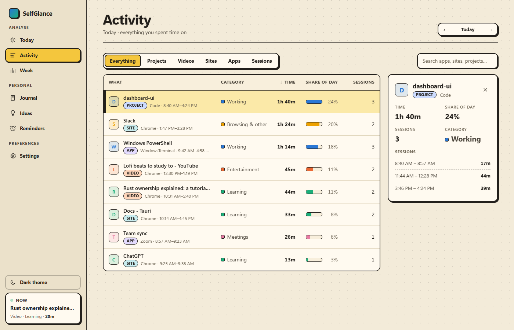
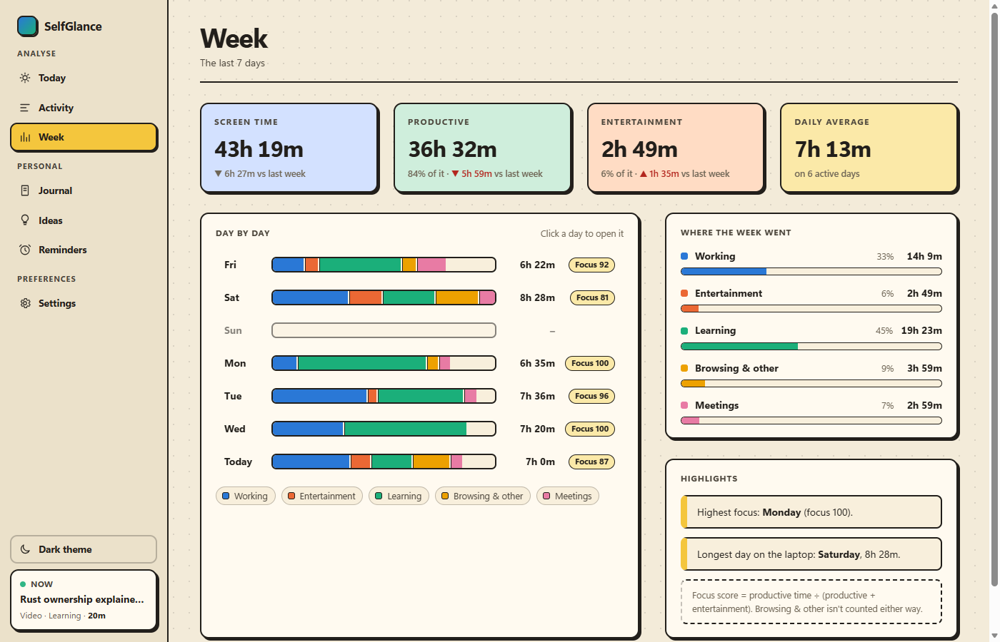
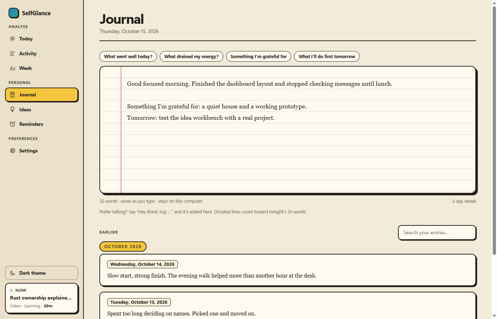
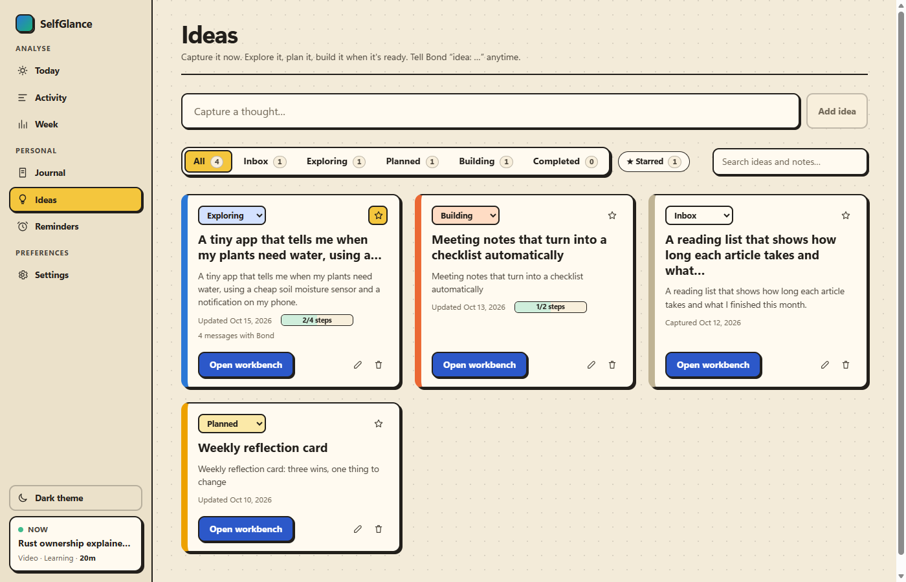
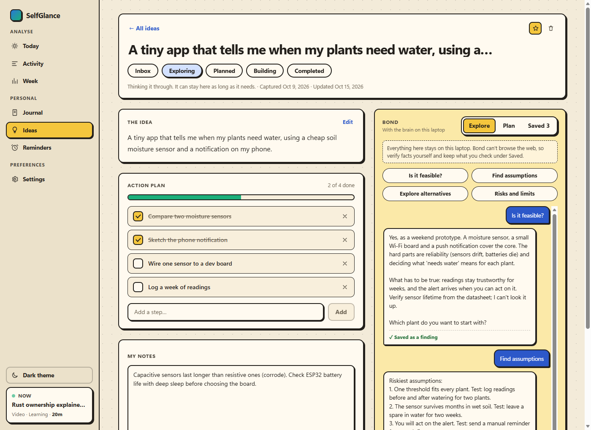
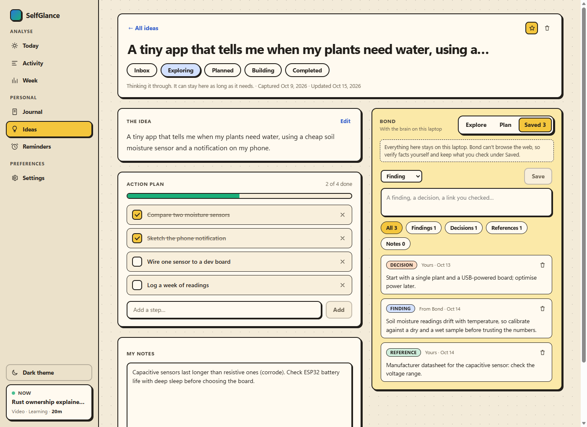
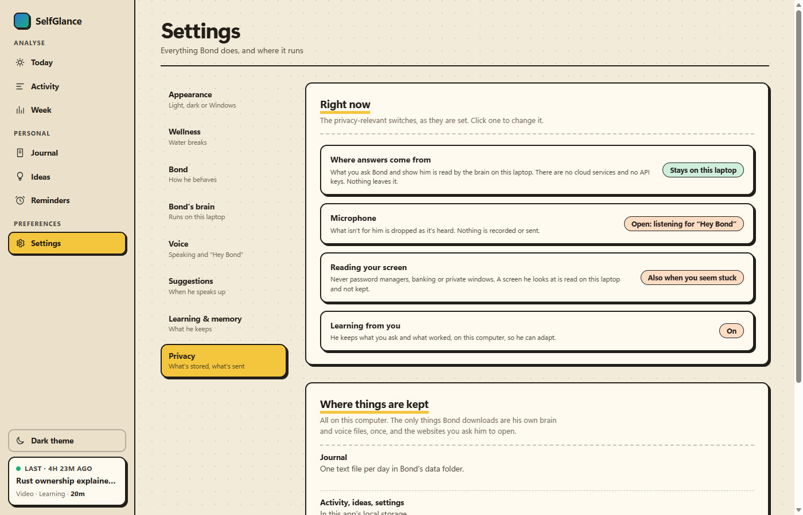
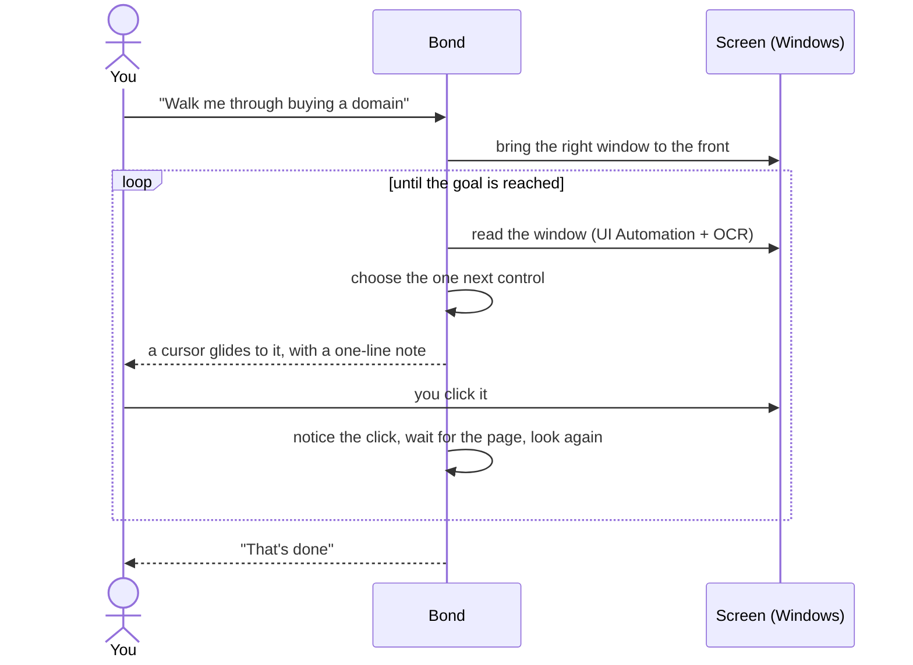
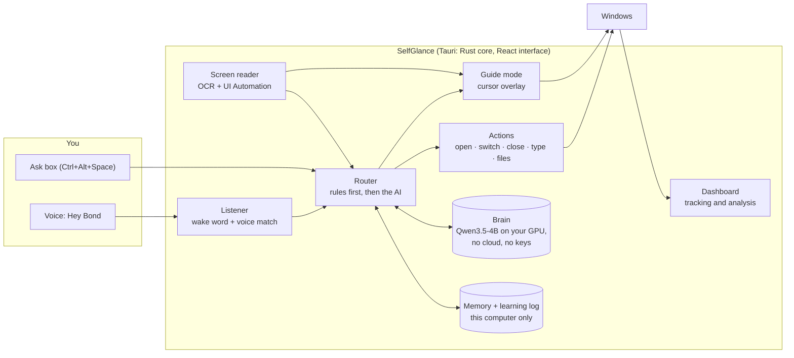

<h1 align="center">SelfGlance</h1>

<p align="center">
  <b>A desktop companion for Windows that knows what you are doing, helps you do it, and keeps it all on your laptop.</b><br/>
  Meet <b>Bond</b>: he understands what you say, reads your screen, points the way, remembers you, and looks after your day.
</p>

<p align="center">
  
  
  
  
  
  
</p>

<p align="center">
  <a href="#what-it-does">What it does</a> ·
  <a href="#tour">Tour</a> ·
  <a href="#guide-mode">Guide mode</a> ·
  <a href="#how-it-works">How it works</a> ·
  <a href="#privacy">Privacy</a> ·
  <a href="#run-it">Run it</a> ·
  <a href="#status">Status</a>
</p>

<p align="center">
  <picture>
    <source media="(prefers-color-scheme: dark)" srcset="docs/screenshots/today-dark.png">
    
  </picture>
</p>

<p align="center"><sub>Screenshots use fictional sample data.</sub></p>

---

## What it does

SelfGlance has two halves that share one brain:

**A dashboard that explains your day.** It records, locally, which app, site, video and project is in front of you, then shows where the time went, how focused you were, and how this week compares with the last.

**Bond, an assistant that lives on your desktop.** Talk to him ("Hey Bond, …") or type to him. He opens and switches apps, reads what is on your screen, walks you through tasks by pointing at each next click, keeps your journal and ideas, reminds you to drink water, and learns what you like. The AI runs **on your laptop** by default.

| | |
|---|---|
| **Understands you** | Speech in and out run locally. A wake word and a voice match mean he answers only you. |
| **Sees the screen** | Windows OCR and UI Automation give him the exact words and the named controls (buttons, fields, links) of the window in front. |
| **Guides, doesn't take over** | Guide mode moves a cursor to the next thing to click and waits for *you* to click it. |
| **Acts, with consent** | Commands, ending programs and deleting files always show exactly what will happen and wait for a yes. |
| **Remembers** | Facts you tell him, the last few minutes of conversation, and what worked before, stored on this computer. |
| **Looks after you** | Water breaks, an evening journal prompt, battery warnings, and suggestions at natural pauses (all optional). |

## Tour

The interface is a soft neo-brutalist design: warm paper, charcoal outlines, offset shadows, a yellow highlighter for what is selected, and matching light and dark themes.

### Today
The day in five seconds: total time, hydration, productive and entertainment time, longest focus, a timeline, the top things you spent time on, and a short list of observations. A Bond tile shows whether he is listening and which brain answers.

### Activity and Week

<table>
<tr>
<td width="50%"></td>
<td width="50%"></td>
</tr>
<tr>
<td><sub><b>Activity.</b> Everything you spent time on: projects, videos, sites and apps, with sortable columns, search and a details panel. An app and a website with the same name are kept apart and explained.</sub></td>
<td><sub><b>Week.</b> Seven days at a glance with comparisons against the week before. Click a day to open it. The focus score is explained on the page.</sub></td>
</tr>
</table>

### Journal and Ideas

<table>
<tr>
<td width="50%"></td>
<td width="50%"></td>
</tr>
<tr>
<td><sub><b>Journal.</b> A notebook page that saves as you type, one file per day. Optional "Journal first" evenings: Bond asks again if you start a video before writing 20 words (dictated words count, and "Not tonight" is always allowed). Streak and skips shown.</sub></td>
<td><sub><b>Ideas.</b> Capture a thought in one line (or tell Bond "idea: …"). Each idea has a stage (Inbox, Exploring, Planned, Building, Completed), a star, and a short title above your untouched original wording.</sub></td>
</tr>
</table>

### The idea workbench

<table>
<tr>
<td width="50%"></td>
<td width="50%"></td>
</tr>
</table>

Open an idea to develop it. Your content sits on cream paper on the left (the idea, an action plan with progress, your own notes); Bond sits in yellow on the right:

- **Explore**: feasibility, assumptions, alternatives, risks, or any question. Keep an answer as a finding or a decision, explicitly.
- **Plan**: ask for next steps, tasks, an MVP or experiments. Bond *suggests*; nothing joins your plan until you approve it.
- **Saved**: findings, decisions, references and notes you chose to keep, filterable.

Bond cannot browse the web, and the panel says so. The whole conversation, your notes included, is read by the brain on your laptop and goes nowhere else.

### Settings and privacy



Eight sections (Appearance, Wellness, Bond, AI models, Voice, Suggestions, Learning & memory, Privacy). The Privacy page reads your real settings and tells you where answers come from, whether the microphone is open, whether Bond may look at your screen, and where everything is kept.

## Guide mode

For jobs you want to do yourself (buying a domain, setting up a recording, finding a setting), say *"Hey Bond, walk me through buying a domain"* or *"help me record my screen in OBS"*. Bond gets the right app in front (opening it, or restoring it if it is minimized), then points at one thing at a time. **He never clicks or types for you in this mode.**



- **Precise by design.** Windows names every button and field in the window, so the model picks a control by id rather than guessing pixel positions. Words on the screen and raw positions are fallbacks, and a debug view (Settings → Bond) outlines every control he saw and the one he chose.
- **Honest about being finished.** He checks whether the goal is already done, asks you to fill a text box before pointing at *Save* or *Next*, and stops if he finds himself going in circles.
- **He learns from your clicks.** Each step is logged locally: what he pointed at and whether you followed it, or what you clicked instead. That is the data for making him better; nothing is sent anywhere.
- **Say "stop" any time.** With "Hey Bond" switched on, "stop", "wait" or "cancel that" works while he works, without repeating the wake word.

## How it works



**Rules first, AI second.** Clear requests ("open Spotify", "remind me in 20 minutes", "close it") are understood instantly by plain code. Only the rest goes to the AI, which answers in a strict JSON format and can only choose from a fixed list of actions, so it cannot invent new ones. Anything powerful passes an approval gate.

### Built with

| Layer | What |
|---|---|
| App shell | [Tauri 2](https://tauri.app) (Rust) with a transparent always-on-top overlay for Bond and a normal window for the dashboard |
| Interface | React 19, TypeScript, Vite, Three.js (Bond's 3D character), plain CSS design tokens (no UI library) |
| Brain | [llama.cpp](https://github.com/ggml-org/llama.cpp) (Vulkan build) running Qwen3.5-4B (Q4_K_M) with its vision projector. No cloud services and no API keys |
| Voice | [sherpa-onnx](https://github.com/k2-fsa/sherpa-onnx): Parakeet (speech to text), Kokoro (speech), TitaNet (voice match) |
| Screen | Windows OCR (`Windows.Media.Ocr`) and UI Automation (`uiautomation` crate) |

### Code map

| Module (`app/src-tauri/src`) | Job |
|---|---|
| `lib.rs` | Overlay window, hotkeys, tray menu, idle and active-app tracking |
| `brain.rs` | Starts, feeds and stops the local model server; waits until it is really loaded |
| `ai.rs` | Routes requests to the local brain; guide mode's step planner |
| `agent.rs` | The actions Bond can take, and the approval gate |
| `screen.rs` | OCR and UI Automation: finds controls by name, with their exact rectangles |
| `system.rs` | Windows (switch, minimize, close), battery, memory, clipboard |
| `voice.rs`, `wake.rs` | Speech in and out; "Hey Bond", voice match, patient end-of-sentence detection |
| `notice.rs` | Decides when a suggestion is worth making |
| `experience.rs`, `memory.rs` | What Bond learns and remembers, on this computer |
| `journal.rs`, `reminders.rs` | Journal files and reminders |

| Folder (`app/src`) | Job |
|---|---|
| `App.tsx`, `stage/` | The overlay: Bond's character, cards, hotkeys, guide loop |
| `dashboard/` | The pages (Today, Activity, Week, Journal, Ideas, Reminders, Settings) and the theme (`dashboard.css` structure, `design.css` components, `neo.css` look, `ideas.css`) |
| `assistant/` | Understanding commands (`intent.ts`), the idea model (`ideacore.ts`), journal and reminder rules, all unit-tested |

About 8,500 lines of Rust and 8,200 of TypeScript, plus styles.

## Privacy

- **Nothing leaves your laptop.** There are no cloud services, no accounts and no API keys. What you ask Bond and show him is read by a model on your own machine. Bond uses the internet for two things only: downloading his own brain and voice files once, and opening websites you ask him to open. Two tests (`egress.rs`, `tests/nocloud.test.ts`) fail if code ever calls an AI service or loads anything from the web.
- **The microphone is explicit.** It is open only while you hold `Ctrl+Alt+V`, or, if you switch on "Hey Bond", while the always-on listener is on (it drops what isn't for him as it hears it; nothing is recorded or sent). A banner in Settings says which.
- **Screen reading is scoped.** Bond looks when you ask, or, if you allow it, when you seem stuck. Never password managers, banking or private windows. Password fields are never read.
- **Everything he keeps is local.** Journal (one text file per day), activity, ideas, settings, the learning log and memories stay on your computer. "Forget" deletes what he learned. Keys that an earlier version saved are deleted on start-up.

## Run it

**You need:** Windows 10 or 11, [Node.js](https://nodejs.org) 22, and [Rust](https://rustup.rs). A GPU with about 6 GB of memory (or 16 GB of RAM) is recommended for the local brain.

```powershell
git clone https://github.com/bashantatiwari/selfglance_app.git
cd selfglance_app\app
npm install
npm run tauri dev
```

The first launch lets you download Bond's brain (about 3.4 GB) and voice (about 830 MB) from the dashboard; nothing large is bundled in the repository. Build an installer with `npm run tauri build`. Pushing a version tag builds one on GitHub Actions (`.github/workflows/release.yml`).

### Using Bond

| Hotkey | Does |
|---|---|
| `Ctrl+Alt+G` | Summon Bond |
| `Ctrl+Alt+Space` | Ask Bond (type a request) |
| Hold `Ctrl+Alt+V` | Talk to Bond; let go when you are done |
| Say **"Hey Bond, …"** | Talk without a hotkey (turn on in Settings → Voice) |

Things to try:

- **Guide:** `walk me through buying a domain` · `help me record my screen using OBS Studio` · `where do I click?`
- **Computer:** `open downloads` · `switch to OBS` · `minimize the terminal` · `volume 30` · `lock my laptop` · `$ ipconfig`
- **Notes:** `log: finished the voice feature` · `idea: an app that sorts downloads` · `remind me in 45 minutes to stretch`
- **Screen:** `what am I looking at` · `I'm stuck`
- **Stop him:** `stop`, `wait`, `never mind` (while he is busy, with "Hey Bond" on)

Running commands, ending programs and deleting files always ask first. Deleting asks twice.

### Tests

```powershell
cd app
npm test                                          # TypeScript: intent, speech, notices, ideas, journal rules
cd src-tauri
cargo test --lib                                  # Rust
cargo test --lib eval -- --ignored --nocapture    # local-model accuracy check (slow, needs the brain)
```

## Status

SelfGlance is an **early, actively developed personal project (v0.1)**. Being straight about it:

- **Windows only.** Screen reading, window control and the brain's runtime are Windows-specific for now.
- **Tuned on one laptop and one voice.** It was built and measured on an RTX 3050 6 GB laptop with 16 GB of RAM. Laptops without a decent GPU would run the brain much more slowly, and lighter model tiers are on the roadmap but not built. The wake word and voice match were tuned on the author's voice and need more testing with others.
- **Guide mode accuracy is not yet measured at scale.** It works well on standard Windows apps; apps that expose few UI Automation controls (some Qt and Electron apps) are harder. The debug view and the local click log exist to improve this.
- **The AI is small.** The 4B model is fast and private, but it makes mistakes a much larger cloud model would not. That is the price of nothing leaving your laptop; the plan is to make a smaller model that is tuned to Bond's own jobs.

Where it is heading, in order, is in [ROADMAP.md](ROADMAP.md): lighter model tiers for ordinary laptops, replaying and learning from the steps you take, weekly reflections built from your journal, and an Android companion.

No license has been chosen yet, so all rights are reserved by default. If you would like to use or contribute to the project, please open an issue.

## Acknowledgements

[Tauri](https://tauri.app), [llama.cpp](https://github.com/ggml-org/llama.cpp), the Qwen team, [sherpa-onnx](https://github.com/k2-fsa/sherpa-onnx) with NVIDIA's Parakeet and TitaNet, Kokoro, and [Three.js](https://threejs.org).
