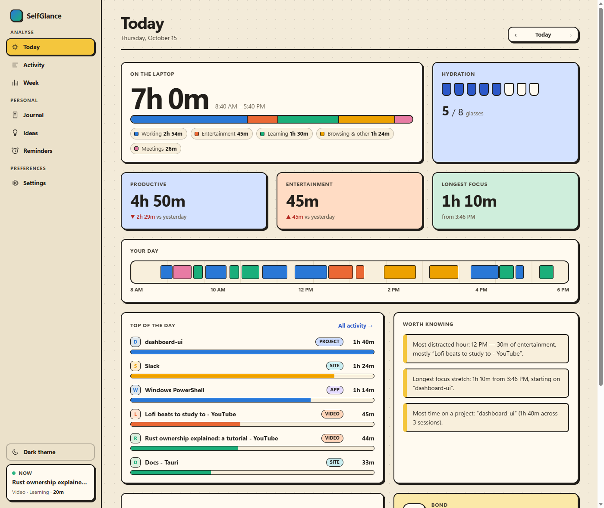
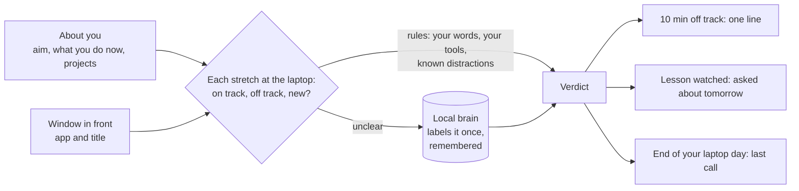
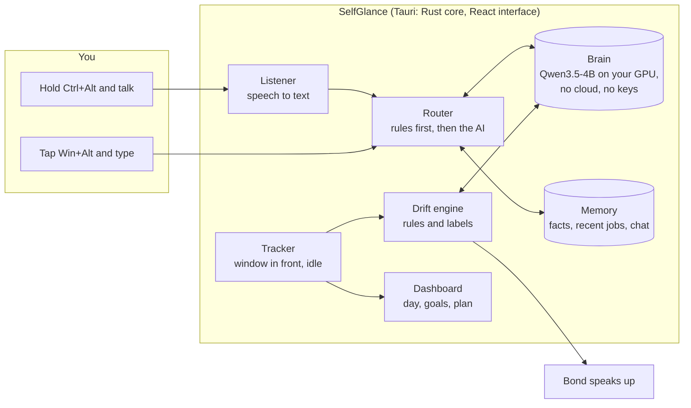

<h1 align="center">SelfGlance</h1>

<p align="center">
  <b>Bond is a desktop companion for Windows. He sees what you meant to do and what you actually do, and speaks up when the two drift apart. All of it stays on your laptop.</b>
</p>

<p align="center">
  
  
  
  
  
  
</p>

<p align="center">
  <a href="#what-it-is">What it is</a> ·
  <a href="#staying-on-track">Staying on track</a> ·
  <a href="#around-it">Around it</a> ·
  <a href="#the-dashboard">Dashboard</a> ·
  <a href="#how-it-works">How it works</a> ·
  <a href="#privacy">Privacy</a> ·
  <a href="#run-it">Run it</a> ·
  <a href="#status">Status</a>
</p>

<p align="center">
  <picture>
    <source media="(prefers-color-scheme: dark)" srcset="docs/screenshots/today-dark.png">
    
  </picture>
</p>

<p align="center"><sub>Screenshots use fictional sample data and may show an earlier version of the interface.</sub></p>

---

## What it is

SelfGlance is built around one question: **are you doing what you meant to do?**

**Bond** lives on your desktop as a small character. You tell him once who you are and where you are headed (Settings → About you): "AI Engineer", "AI security intern", "making AI videos". From then on he notes which window is in front of you, judges each stretch against that, and says something when it matters: when you have drifted for ten minutes, when a tutorial you watched yesterday led nowhere, when your laptop day is ending and the study didn't happen. Hold `Ctrl+Alt` to talk to him; he answers out loud.

**The dashboard** shows how the day really went: time on the laptop, what counted toward your aim and what didn't, today's plan and focus, your ideas.

What it deliberately is not: a cloud assistant or a bundle of features. It stays small, and it stays on your laptop.

| | |
|---|---|
| **Knows what you're for** | A few lines about you are enough. No timetable to fill in: he judges whenever you are at the laptop. |
| **Speaks up, briefly** | One spoken line when you drift, with "that counts" and "not now" as answers. At most two nudges an hour. |
| **Follows through** | Lessons you watch are written down, and the next day he asks what came of one. |
| **Talks back fast** | A conversation answer starts in about a second, spoken as it is written. |
| **Does small jobs** | Open apps and sites, timers, reminders, volume, files, laptop status. Commands, ending programs and deleting files always ask first. |
| **Private by construction** | The AI, the voice and the memory all run on your laptop. No account, no keys, no cloud. |

## Staying on track



- **No goal needed.** A focus for the day ("goal: finish the LangGraph agent") sharpens it, but without one Bond judges against About you. Weekends can be like any day, for your projects, or days off.
- **Drift.** About ten minutes in a row off track brings one spoken line and a card: *Back to it*, *This is on-goal* (he remembers), or *Not now* (quiet for 30 minutes).
- **Follow-through.** Anything that looks like a lesson and holds you for ten minutes or more is written down. From the next day he asks about one a day: *used it*, *I'll do it today* (he asks again tomorrow), or *drop it*.
- **End of the day.** Forty-five minutes before your laptop day ends (About you), if under half an hour went toward your aim, he says so; after it ends, that it is time to close up.
- **Sunday.** A look back at the week, with a few suggestions drawn from its numbers.

## Around it

**Talk.** Ask anything; the answer streams and he starts speaking after the first sentence. He knows what you told him about yourself and what you said recently.

**Write for you.** Ask for a message, a reply or a bio. He writes it, you read it, and *Put in the box* pastes it where you were typing. He never presses Send.

**Timers and reminders.** "Start a timer of 10 seconds" shows a countdown you can shrink or cancel. "Remind me at 5pm to submit the report" is said when it is due.

**Water breaks.** After a stretch of active use, a bottle arrives. Taking a real break on your own counts.

## The dashboard

| Page | What it is for |
|---|---|
| **Today** | The day at a glance: time on the laptop, hydration, productive time, longest focus, a timeline, top apps, a few observations. |
| **Activity** | Everything you spent time on, searchable and sortable. You can **forget** any item or any single session, with Undo. Bond's own record shrinks with it. |
| **Goals** | Today's focus, tomorrow's, how today is going toward it, how each stretch was counted (and corrections), and the week. |
| **Plan** | What you want to do today, fitted around anything with a fixed time. |
| **Ideas** | Write a thought down fast. Click an idea to open it and edit the idea and its notes, which save as you type. |
| **Settings** | About you, wellness, Bond, his brain, voice, memory, privacy. |

The interface is a soft neo-brutalist design: warm paper, charcoal outlines, offset shadows, matching light and dark themes.

## How it works



**Rules first, AI second.** Clear requests ("open Spotify", "start a timer of 10 seconds", "goal for tomorrow: study X") are understood instantly by plain code. Only the rest goes to the AI, which answers in a strict JSON format and can only choose from a fixed list of actions; talk is answered separately and streamed. Anything powerful passes an approval gate. The drift engine works the same way: rules judge what they can, and the brain only labels what they can't.

**The keys.** Hold `Ctrl+Alt` to talk (as long as you like, up to 30 seconds, so slow speakers and pauses are fine). Tap `Win+Alt` to type. `Ctrl+Alt+G` summons Bond. The two modifier-only keys are found by watching which keys are down (`hotkeys.rs`); nothing is recorded.

### Built with

| Layer | What |
|---|---|
| App shell | [Tauri 2](https://tauri.app) (Rust) with a transparent always-on-top overlay for Bond and a normal window for the dashboard |
| Interface | React 19, TypeScript, Vite, Three.js (Bond's character), plain CSS design tokens |
| Brain | [llama.cpp](https://github.com/ggml-org/llama.cpp) (Vulkan build) running Qwen3.5-4B (Q4_K_M) with its vision projector; every download is checked against a pinned SHA-256 |
| Voice | [sherpa-onnx](https://github.com/k2-fsa/sherpa-onnx): Parakeet (speech to text), Kokoro (speech), TitaNet (voice match, optional) |
| Screen | Windows OCR (`Windows.Media.Ocr`) and UI Automation (`uiautomation` crate) |

### Code map

| Module (`app/src-tauri/src`) | Job |
|---|---|
| `lib.rs`, `hotkeys.rs` | Overlay window, tray, shortcuts (including the modifier-only keys), idle and active-app tracking |
| `brain.rs` | Starts, feeds and stops the local model server |
| `ai.rs` | Routes requests to the brain; streamed talk; looking at the screen when asked |
| `agent.rs`, `policy.rs` | The actions Bond can take, and what the AI is allowed to plan |
| `screen.rs`, `capture.rs` | OCR and UI Automation; keeping Bond out of screenshots |
| `system.rs` | Windows (switch, minimize, close), battery, memory, specs, clipboard |
| `voice.rs`, `wake.rs` | Speech in and out; optional "Hey Bond" and voice match |
| `draft.rs` | Writing for you, with the context Bond has |
| `memory.rs`, `experience.rs`, `goals.rs` | Facts and recent jobs; the learning log; goal labelling |
| `notice.rs`, `egress.rs` | Optional suggestions; the no-cloud guard |

| Folder (`app/src`) | Job |
|---|---|
| `App.tsx`, `stage/`, `ui/` | The overlay: Bond's character, his cards, timers |
| `dashboard/` | Today, Activity, Goals, Plan, Ideas, Settings (with About you and Memory) and the theme |
| `assistant/` | Understanding commands (`intent.ts`), the drift rules (`goals.ts`), follow-through (`followup.ts`), plan, timers, reminders, all unit-tested |
| `break/` | The water-break coach |

## Privacy

- **Nothing leaves your laptop.** No cloud services, no accounts, no API keys. What you ask Bond and show him is read by a model on your own machine. The internet is used for two things only: downloading his brain and voice files once, and opening websites you ask for. Tests (`egress.rs`, `tests/nocloud.test.ts`) fail if code ever calls an AI service. The few "Learn more" links in Settings open only on your click, in your own browser.
- **The microphone is explicit.** It is open only while you hold `Ctrl+Alt` (or while the optional "Hey Bond" listener is on, which drops what isn't for him as it hears it).
- **What he tracks is the window in front: its app and title.** Kept on this laptop, forgettable item by item. The screen itself is read only when you ask ("what's on my screen"); never password managers, banking or private windows, and password fields are never read.
- **You can forget.** Delete any activity or session from the record; the learning log and memories can be cleared in Settings. Everything is stored on this computer.

## Run it

**You need:** Windows 10 or 11, [Node.js](https://nodejs.org) 22, and [Rust](https://rustup.rs). A GPU with about 6 GB of memory (or 16 GB of RAM) is recommended for the local brain.

```powershell
git clone https://github.com/bashantatiwari/selfglance_app.git
cd selfglance_app\app
npm install
npm run tauri dev
```

The first launch lets you download Bond's brain (about 3.4 GB) and voice (about 830 MB) from Settings; nothing large is bundled. Build an installer with `npm run tauri build`.

Things to try:

- **About you:** fill in Settings → About you first; it is what Bond judges against.
- **Talk:** `how do I set up a Python virtual environment` · `the day was rough`
- **Timers:** `start a timer of 10 seconds` · `set a 25 minute timer for focus`
- **Write:** `I need a bio for my channel` · `write a polite reply declining the invite`
- **Goals:** `goal: finish the micrograd tutorial` · `goal for tomorrow: study diffusion transformers`
- **Reminders:** `remind me in 10 minutes to stretch` · `set a timer for 5 minutes`
- **Computer:** `open downloads` · `switch to OBS` · `what are my laptop specs` · `search standing desks in Brave`
- **Ideas:** `idea: an app that sorts my downloads`

Running commands, ending programs and deleting files always ask first. Deleting asks twice.

### Tests

```powershell
cd app
npm test                                          # TypeScript rules and parsers
npx tsc --noEmit
cd src-tauri
cargo test --lib                                  # Rust
cargo test --lib eval::heldout -- --ignored --nocapture   # router accuracy on unseen requests (needs the brain)
```

`docs/RELEASE-BREAK-PLAN.md` is the checklist for trying to break a build before release.

## Status

An **early, actively developed personal project (v0.1)**. Being straight about it:

- **Windows only.** Screen reading, window control and the brain's runtime are Windows-specific for now.
- **Measured on one laptop** (RTX 3050 6 GB, 16 GB RAM). Router accuracy on 75 unseen requests: 71 correct, none harmful. Goal labelling on 34 cases: 31 correct. Laptops without a decent GPU will be slower, and lighter model tiers are planned, not built.
- **The drift engine is new.** It judges from window titles only, so it is sometimes wrong; correcting a stretch once teaches it. It sees only this laptop: time on your phone is invisible to it.
- **The AI is small.** A 4B model is fast and private, but it makes mistakes a large cloud model would not, and it has no internet: it can't look up news, prices or anything recent.
- **Voice** is tuned on the author's voice and needs more testing with others.

The plan is in [ROADMAP.md](ROADMAP.md). No license has been chosen yet, so all rights are reserved by default; to use or contribute, please open an issue.

## Acknowledgements

[Tauri](https://tauri.app), [llama.cpp](https://github.com/ggml-org/llama.cpp), the Qwen team, [sherpa-onnx](https://github.com/k2-fsa/sherpa-onnx) with NVIDIA's Parakeet and TitaNet, Kokoro, and [Three.js](https://threejs.org).
